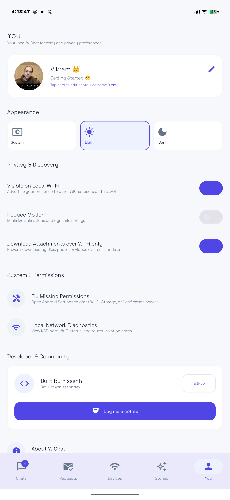
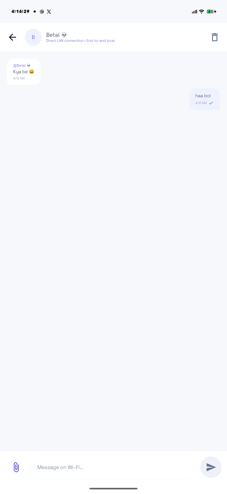
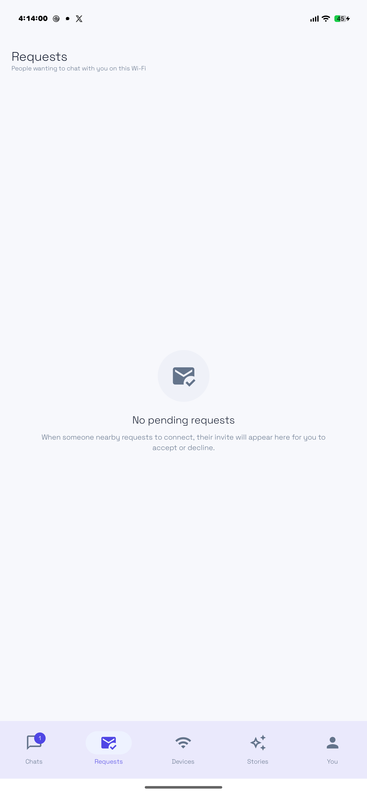
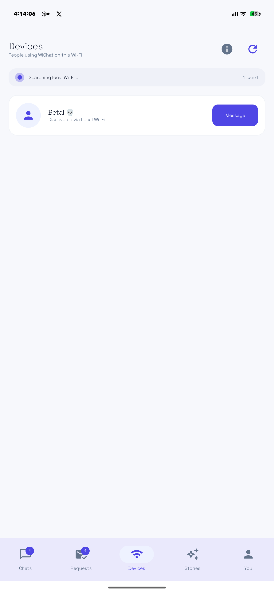
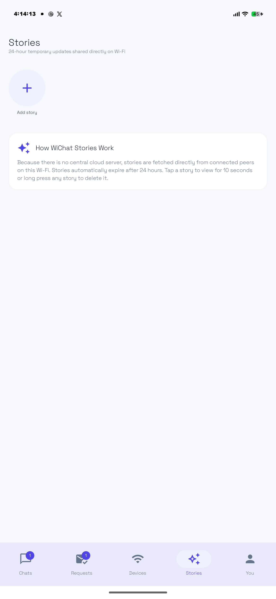
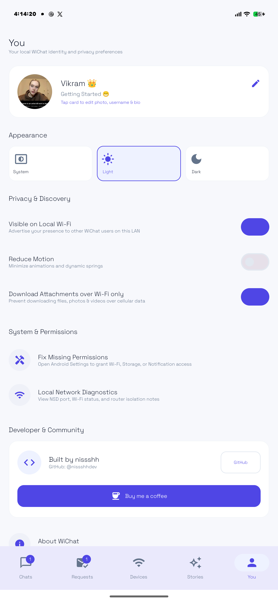

# WiChat 💬
### Peer-to-Peer Local Wi-Fi Messenger for Android

WiChat is a native Android messenger designed for offline, local-network communication. It lets two or more people chat, share photos and videos, and post temporary stories with anyone on the same Wi-Fi network — **without the internet, without phone numbers or emails, and without any cloud servers**.

Everything stays on your local network. No tracking, no metadata collection, and zero third-party intermediaries.

---

## 📸 Screenshots

<p align="center">
  
  
  
</p>

<p align="center">
  
  
  
</p>

---

## ✨ Features

- **Zero Cloud Dependence**: Operates entirely over local Wi-Fi / LAN using Android Network Service Discovery (mDNS) with resilient UDP broadcast fallback.
- **Direct & Group Chats**: Instant messaging between local peers and local group conversations without external servers.
- **In-App Media Preview**: View shared photos and stream videos directly within the app using the built-in media viewer.
- **Save to Downloads**: Long-press any media or attachment to export it directly to your phone's public `Downloads/WiChat` folder.
- **24-Hour Local Stories**: Share temporary updates with peers on your Wi-Fi. Features a full-screen 10-second viewer with animated progress timer and long-press deletion.
- **Smart Foreground Notifications**: Keeps you informed with connection request alerts without cluttering your screen with message popups when you're already actively chatting.
- **Identity & Passcode Protection**: Each device generates an RSA-2048 keypair on first launch using Android Keystore. Chats can be protected with an optional 6-digit passcode.
- **Material 3 Design System**: Clean, textured backgrounds for both Light and Dark modes with responsive micro-animations and typography.

---

## 🛠 Tech Stack

- **UI**: 100% Jetpack Compose with Material 3 Foundation
- **Language**: Kotlin & Coroutines / StateFlow (Unidirectional Data Flow)
- **Database**: Room Database for local-first storage
- **Preferences**: Jetpack DataStore Preferences
- **Discovery**: Android `NsdManager` (DNS-SD / mDNS) + UDP Subnet Broadcast fallback
- **Sockets**: Raw non-blocking TCP sockets with custom `WiChatPacket` framing
- **Security**: Android Keystore (RSA-2048 identity key generation) + PBKDF2/SHA-256 for passcode hashing

---

## 🚀 Getting Started

### Prerequisites
- Android Studio Ladybug (2024.2.1+) or command-line Android SDK
- JDK 17
- Android Device running Android 8.0 (API 26) or higher

### Building from Source

1. **Clone the repository:**
   ```bash
   git clone https://github.com/nissshhdev/WiChat.git
   cd WiChat
   ```

2. **Build Debug APK:**
   ```bash
   ./gradlew assembleDebug
   ```
   The APK will be generated at:
   `app/build/outputs/apk/debug/app-debug.apk`

3. **Build Release APK:**
   ```bash
   ./gradlew assembleRelease
   ```
   The APK will be generated at:
   `app/build/outputs/apk/release/app-release.apk`

4. **Install to Connected Device:**
   ```bash
   adb install -r app/build/outputs/apk/release/app-release.apk
   ```

---

## 💡 How It Works Under the Hood

1. **Service Announcement**: When WiChat opens, it binds an ephemeral TCP server port and advertises itself using Android's `NsdManager` service type `_wichat._tcp`.
2. **Subnet Broadcast Fallback**: Some home and office routers throttle or block mDNS multicast. WiChat automatically maintains a lightweight UDP broadcast heartbeat on port `54321` so peers discover each other even on tricky networks.
3. **Connection Requests**: To protect privacy, sending a message to a newly discovered peer triggers an invite request that the recipient can accept or decline before messages flow.
4. **End-to-End Direct**: Messages and media packets are streamed directly between device IPs via local sockets. If your device disconnects from the Wi-Fi, messages simply queue safely on your device until reconnected.

---

## ☕ Support & Community

Created with care by **nissshh** 🇮🇳 ([@nissshhdev](https://github.com/nissshhdev)).

If you find WiChat useful, please consider starring the repository and supporting the project:

[](https://github.com/nissshhdev/WiChat)
[](https://buymeacoffee.com/nissshhdevz)

---

## 📄 License

This project is licensed under the MIT License - see the LICENSE file for details.
